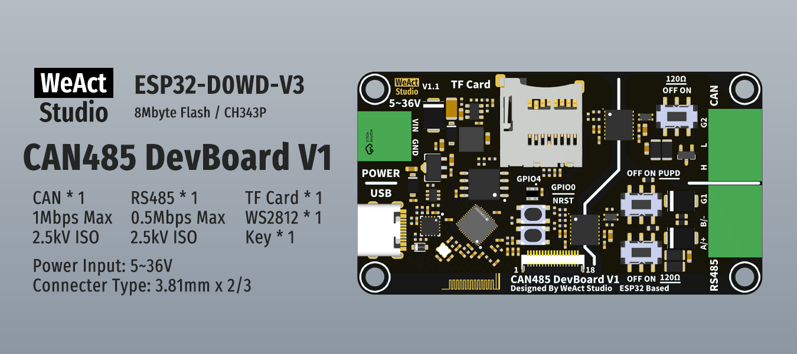

* [中文版本](./README_zh.md)
# WeActStudio.CAN485DevBoardV1_ESP32


|Dir Name|Explain|
| :--:|:--:|
|Doc|DataSheet|
|Hardware|Hardware Development Kit|
|Examples|Examples|

## Hardware Version
```
**V1.0**
- Initial version.

**V1.1**
- Use FPC-18Pin-0.5mm connector to output ESP32 idle pins.
```

## Attention
1. Pressing the GPIO0 key to power on will keep the device in Boot mode. It needs to be powered on again to run.
2. When burning the firmware, the TF card needs to be removed; otherwise, the burning process will fail.
3. Arduino Development Environment:
   - ESP32 board: `ESP32 Dev Module`

## Pinout
```
// TF Card
"CS": GPIO13,
"SCK": GPIO14,
"MOSI": GPIO15,
"MISO": GPIO2,

// RS485
"DE": GPIO17,
"RO": GPIO21,
"DI": GPIO22,

// CAN
"RX": GPIO26,
"TX": GPIO27,

// Input Voltage
"VIN": GPIO36,
int analogVolts = analogReadMilliVolts(36);
int vin_Volts = analogVolts * ( 51 + 510 + 51 ) / 51;

// WS2812
"LED": GPIO4,

// KEY
"KEY": GPIO0,

// FPC-18Pin-0.5mm Connector (Hardware version >= V1.1)
"PIN1": GND,
"PIN2": 3.3V,
"PIN3": GPIO37,
"PIN4": GPIO38,
"PIN5": GPIO39,
"PIN6": GPIO34,
"PIN7": GPIO35,
"PIN8": GPIO32,
"PIN9": GPIO33,
"PIN10": GPIO25,
"PIN11": GPIO12,
"PIN12": GPIO5,
"PIN13": GPIO23,
"PIN14": GPIO19,
"PIN15": GPIO16,
"PIN16": GPIO18,
"PIN17": 5V,
"PIN18": GND,
```
#

```
/*---------------------------------------
- WeAct Studio Official Link
- taobao: weactstudio.taobao.com
- aliexpress: weactstudio.aliexpress.com
- github: github.com/WeActStudio
- gitee: gitee.com/WeActStudio
- blog: blog.weactstudio.com
---------------------------------------*/
```
