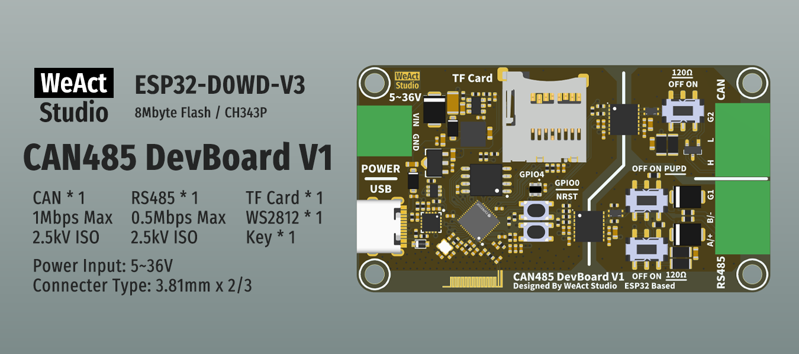

* [English version](./README.md)
# WeActStudio.CAN485DevBoardV1_ESP32


|目录名称|内容|
| :--:|:--:|
|Doc| 数据手册|
|Hardware| 硬件开发资料|
|Examples|示例|

## 硬件版本说明
```
**V1.0**
- 初始版本。

**V1.1**
- 使用FPC-18Pin-0.5mm连接器引出ESP32空闲管脚。
```

## 注意事项
1. 按住GPIO0键上电，会一直处于Boot模式，需要重新上电才能运行。
2. 固件烧录时需要弹出TF卡，否则会导致烧录失败。
3. Arduino开发环境：
   - ESP32开发板：`ESP32 Dev Module`

## 管脚说明
```
// TF Card
"CS": GPIO13,
"SCK": GPIO14,
"MOSI": GPIO15,
"MISO": GPIO2,

// RS485
"DE": GPIO17,
"RO": GPIO21,
"DI": GPIO22,

// CAN
"RX": GPIO26,
"TX": GPIO27,

// Input Voltage
"VIN": GPIO36,
int analogVolts = analogReadMilliVolts(36);
int vin_Volts = analogVolts * ( 51 + 510 + 51 ) / 51;

// WS2812
"LED": GPIO4,

// KEY
"KEY": GPIO0,

// FPC-18Pin-0.5mm Connector (Hardware version >= V1.1)
"PIN1": GND,
"PIN2": 3.3V,
"PIN3": GPIO37,
"PIN4": GPIO38,
"PIN5": GPIO39,
"PIN6": GPIO34,
"PIN7": GPIO35,
"PIN8": GPIO32,
"PIN9": GPIO33,
"PIN10": GPIO25,
"PIN11": GPIO12,
"PIN12": GPIO5,
"PIN13": GPIO23,
"PIN14": GPIO19,
"PIN15": GPIO16,
"PIN16": GPIO18,
"PIN17": 5V,
"PIN18": GND,
```

```
/*---------------------------------------
- WeAct Studio Official Link
- taobao: weactstudio.taobao.com
- aliexpress: weactstudio.aliexpress.com
- github: github.com/WeActStudio
- gitee: gitee.com/WeActStudio
- blog: blog.weactstudio.com
---------------------------------------*/
```